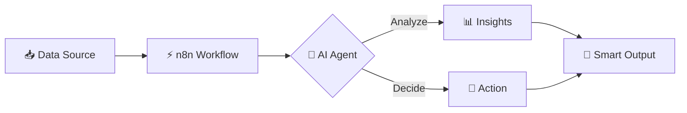

<!-- ═══════════════════════════════════════════════════════════
     Profile README for Mawada Mohammed (@Mawadamohammed)
     Tip: save this file as README.md inside a PUBLIC repository
     named exactly:  Mawadamohammed/Mawadamohammed
     ═══════════════════════════════════════════════════════════ -->

<div align="center">


<a href="https://git.io/typing-svg">
  
</a>

<br/>


</div>

<br/>

---

## 🌸 &nbsp;Hello, I'm Mawada!

<table>
<tr>
<td width="62%" valign="top">

I'm a **Data Engineering student** who loves building things that think, move, and work on their own.
I design **AI-powered automations** that turn messy data into smart, reliable workflows, so people can spend their time on what really matters.

- 🎓 &nbsp;Studying **Data Engineering**
- 🤖 &nbsp;Building **AI Agents** & intelligent automations
- ⚡ &nbsp;Crafting end-to-end workflows with **n8n**
- 📊 &nbsp;Turning raw data into insight through **Data Analysis**
- 🛍️ &nbsp;Working with **Trendy Finds EG**
- 🌱 &nbsp;Currently deepening my skills in **data pipelines, LLMs & cloud**
- 💬 &nbsp;Ask me about **automation, AI agents, and data**

</td>
<td width="38%" align="center" valign="middle">

```text
  ╭──────────────────────────╮
  │  const mawada = {        │
  │    role: "Data Engineer",│
  │    focus: ["AI Agents",  │
  │            "Automation", │
  │            "Analytics"], │
  │    tool: "n8n ⚡",        │
  │    mood: "curious 🌸",    │
  │    coffee: Infinity      │
  │  };                      │
  ╰──────────────────────────╯
```

</td>
</tr>
</table>

---

## 🛠️ &nbsp;Tech Stack & Tools

<div align="center">

**⚡ Automation & AI**


**📊 Data & Analytics**


**🌐 Web & Dev Tools**


</div>

---

## 🚀 &nbsp;What I Do

<table align="center">
<tr>
<td align="center" width="25%">
<h3>🤖</h3>
<b>AI Agents</b><br/>
<sub>Smart assistants that reason, decide, and take action</sub>
</td>
<td align="center" width="25%">
<h3>⚡</h3>
<b>Workflow Automation</b><br/>
<sub>n8n flows connecting apps, APIs, and data</sub>
</td>
<td align="center" width="25%">
<h3>🧱</h3>
<b>Data Engineering</b><br/>
<sub>Clean, reliable pipelines from source to insight</sub>
</td>
<td align="center" width="25%">
<h3>📊</h3>
<b>Data Analysis</b><br/>
<sub>Dashboards and stories hidden inside the numbers</sub>
</td>
</tr>
</table>

---

## 📌 &nbsp;Featured Project

<div align="center">

<a href="https://github.com/Mawadamohammed/mawada-portfolio">
  
</a>

</div>

> 💡 **More projects are on the way:** AI agents, n8n workflows, and data pipelines. Stay tuned! ✨

---

## 🔁 &nbsp;How I Think About Automation



---

## 📈 &nbsp;GitHub Stats

<div align="center">


</div>

---

## 🎯 &nbsp;Goals for This Year

- [x] Start my journey in **Data Engineering**
- [x] Build my first **n8n automations** and **AI agent** workflows
- [x] Launch my personal **portfolio**
- [ ] Master **data pipelines** & orchestration (Airflow, dbt)
- [ ] Ship **5+ real-world AI automation projects**
- [ ] Learn **cloud data platforms** (AWS / GCP)
- [ ] Contribute to an **open-source** project

---

## 💬 &nbsp;Let's Connect

<div align="center">

<!-- ✏️ Replace the "#" placeholders below with your real links -->
<a href="https://www.linkedin.com/in/YOUR-LINKEDIN"></a>
<a href="mailto:YOUR-EMAIL@example.com"></a>
<a href="https://github.com/Mawadamohammed/mawada-portfolio"></a>
<a href="https://t.me/YOUR-TELEGRAM"></a>

<br/><br/>

<i>✨ "Data is the new oil, but automation is the engine." ✨</i>

<br/><br/>


</div>
